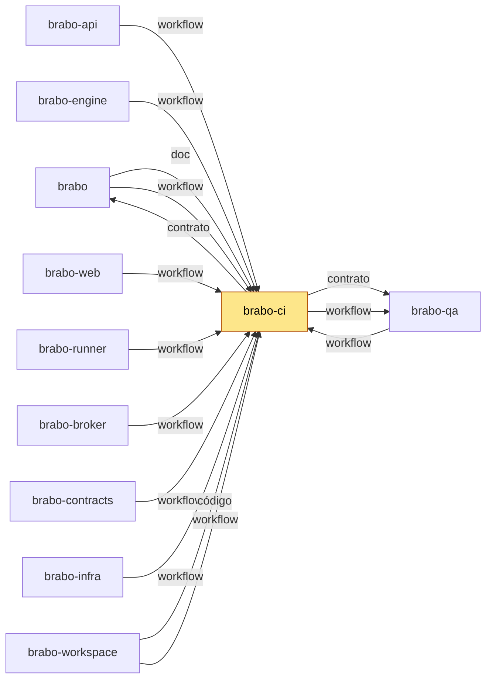

# brabo-ci

[](https://github.com/viralabs-dev/brabo-ci/actions/workflows/ci.yml?query=branch%3Adev) [](https://github.com/viralabs-dev/brabo-ci/actions/workflows/ci.yml?query=branch%3Amain) [](https://github.com/viralabs-dev/brabo-ci/tags) [](LICENSE) [](https://viralabs-dev.github.io/brabo/prd/) [](https://ko-fi.com/daneiel)

Workflows reutilizáveis, actions e modelos de comunidade que dão a um conjunto de repositórios a mesma política de PR, tag e promoção.

## Para que existe

Quando um produto vira vários repositórios, cada um precisa das mesmas regras: nome de branch, aprovação, promoção `dev` para `main`, tag e Dependabot. Copiar essas regras repo a repo as deixa divergir. Aqui elas moram uma vez, como **workflows reutilizáveis** (`on: workflow_call`), e cada repo as chama pinadas por SHA. Depois de ler, você sabe dizer por que a política do Brabo não está duplicada em 11 lugares.

## Onde se encaixa

Todos os repos do Brabo chamam os reutilizáveis daqui; o brabo-ci, por sua vez, só lê o `repos.yml` do brabo e o catálogo do brabo-qa. Quem muda aqui muda a política de todos, por isso cada repo pina um SHA e sobe de versão por PR.

<!-- mapa:inicio -->
<!-- Gerado do repos.yml do brabo por brabo-ci:scripts/ci/mapa-dos-repos.ts. Não edite à mão. -->

**brabo-ci** — Workflows reutilizáveis e a política de PR, escada de aprovação, promoção, tag e Dependabot. Cada repo chama `uses: viralabs-dev/brabo-ci/...@<sha>`, fixado por SHA.

| repo | propósito | como é usado | depende de | é usado por |
|---|---|---|---|---|
| [brabo](https://github.com/viralabs-dev/brabo) | Porta de entrada do produto — documentação agregada, site, instalador e release. | Quem instala usa o `install.sh` e as imagens e o binário das tags de `componentes.json`; o brabo-infra o clona nas aferições cruzadas. | brabo-api (imagem, doc), brabo-engine (imagem, doc), brabo-web (imagem, doc), brabo-broker (imagem, doc), brabo-runner (imagem, doc), brabo-infra (imagem, código, doc), brabo-contracts (contrato, doc), brabo-ci (doc, workflow), brabo-qa (doc) | brabo-ci (contrato), brabo-infra (código), brabo-workspace (código) |
| [brabo-api](https://github.com/viralabs-dev/brabo-api) | API do produto (NestJS, Drizzle, PostgreSQL/pgvector) — schema, RBAC, LLM, metering e gates. | Imagem publicada por tag e consumida pelo brabo e pelo brabo-infra; o brabo-web, o brabo-engine e o brabo-qa leem o código ou o `openapi.json` dele. | brabo-contracts (contrato), brabo-infra (código), brabo-qa (workflow), brabo-ci (workflow) | brabo (imagem, doc), brabo-engine (código), brabo-web (contrato), brabo-contracts (contrato), brabo-infra (código), brabo-qa (código), brabo-workspace (código) |
| [brabo-engine](https://github.com/viralabs-dev/brabo-engine) | Engine (Elixir/OTP, Phoenix, Oban) — agentes, sessões, gates e roteamento de runners. | Imagem publicada por tag, usada pelo brabo e pelo brabo-infra. | brabo-contracts (contrato), brabo-api (código), brabo-runner (código), brabo-qa (workflow), brabo-ci (workflow) | brabo (imagem, doc), brabo-infra (código), brabo-qa (código), brabo-workspace (código) |
| [brabo-web](https://github.com/viralabs-dev/brabo-web) | Interface web (React 19, Vite) — telas, i18n e design system. | Imagem publicada por tag, usada pelo brabo e pelo brabo-infra. | brabo-contracts (contrato), brabo-api (contrato), brabo-qa (workflow), brabo-ci (workflow) | brabo (imagem, doc), brabo-infra (código), brabo-qa (código), brabo-workspace (código) |
| [brabo-runner](https://github.com/viralabs-dev/brabo-runner) | CLI `brabo-runner` na máquina do usuário — PTY, container local e espelho. | Binário publicado por tag, instalado pelo brabo; o brabo-engine e o brabo-qa leem o código dele nos testes. | brabo-contracts (contrato), brabo-ci (workflow) | brabo (imagem, doc), brabo-engine (código), brabo-infra (código), brabo-qa (código), brabo-workspace (código) |
| [brabo-broker](https://github.com/viralabs-dev/brabo-broker) | Único processo com o socket do Docker do servidor. | Imagem publicada por tag, usada pelo brabo e pelo brabo-infra. | brabo-contracts (contrato), brabo-qa (workflow), brabo-ci (workflow) | brabo (imagem, doc), brabo-infra (código), brabo-qa (código), brabo-workspace (código) |
| [brabo-contracts](https://github.com/viralabs-dev/brabo-contracts) | Contratos compartilhados — os pacotes `shared` e `docker-port`, `areas.json` e `fluxo.yml`. | Consumido por TAG (pacote no GitHub Packages ou arquivo baixado por raw na mesma tag); uma tag nova pede bump em api, web, runner, broker, engine, qa e infra. | brabo-api (contrato), brabo-ci (workflow) | brabo (contrato, doc), brabo-api (contrato), brabo-engine (contrato), brabo-web (contrato), brabo-runner (contrato), brabo-broker (contrato), brabo-infra (código), brabo-qa (contrato), brabo-workspace (código) |
| **brabo-ci** | Workflows reutilizáveis e a política de PR, escada de aprovação, promoção, tag e Dependabot. | Cada repo chama `uses: viralabs-dev/brabo-ci/...@<sha>`, fixado por SHA. | brabo-qa (contrato, workflow), brabo (contrato) | brabo (doc, workflow), brabo-api (workflow), brabo-engine (workflow), brabo-web (workflow), brabo-runner (workflow), brabo-broker (workflow), brabo-contracts (workflow), brabo-infra (workflow), brabo-qa (workflow), brabo-workspace (código, workflow) |
| [brabo-infra](https://github.com/viralabs-dev/brabo-infra) | Composes, Dockerfiles de integração, `deploy/k8s`, scripts de dev, release e cadeia de suprimentos. | O brabo clona o brabo-infra no ref de `componentes.json` para subir a instalação; o brabo-api e o brabo-qa o clonam no CI. | brabo-api (código), brabo-engine (código), brabo-web (código), brabo-broker (código), brabo-runner (código), brabo-contracts (código), brabo (código), brabo-qa (workflow), brabo-ci (workflow) | brabo (imagem, código, doc), brabo-api (código), brabo-qa (código), brabo-workspace (código) |
| [brabo-qa](https://github.com/viralabs-dev/brabo-qa) | E2E de navegador (Playwright), golden-sets e catálogo de funcionalidades — o portão da `main`. | O brabo-ci dispara o `e2e-pr` dele e lê o `funcionalidades.yml`; api, engine, web, broker e infra o chamam como portão. | brabo-api (código), brabo-engine (código), brabo-web (código), brabo-runner (código), brabo-broker (código), brabo-infra (código), brabo-contracts (contrato), brabo-ci (workflow) | brabo (doc), brabo-api (workflow), brabo-engine (workflow), brabo-web (workflow), brabo-broker (workflow), brabo-ci (contrato, workflow), brabo-infra (workflow), brabo-workspace (código) |
| [brabo-workspace](https://github.com/viralabs-dev/brabo-workspace) | Pasta-mãe `~/dev/brabo/` com os clones lado a lado e o `clonar-tudo.sh`. | Quem desenvolve roda `clonar-tudo.sh` uma vez; as sessões do Claude abrem nela. | brabo (código), brabo-api (código), brabo-engine (código), brabo-web (código), brabo-runner (código), brabo-broker (código), brabo-contracts (código), brabo-ci (código, workflow), brabo-infra (código), brabo-qa (código) | — |


<!-- mapa:fim -->

## Como é usado

Cada reutilizável faz um segundo checkout deste repo em `.brabo-ci/` e roda `node .brabo-ci/scripts/ci/<script>.ts`. Por isso todos têm o input `ci_ref`, obrigatório e sem padrão: o **mesmo SHA de 40 hex** do `uses:`, que o reutilizável não consegue descobrir sozinho. Pine sempre por SHA, com `# vX.Y.Z` ao lado. Copie e troque `<sha>`:

```yaml
# .github/workflows/politica.yml no repositório que chama
name: politica
on:
  pull_request:
    types: [opened, edited, reopened, synchronize, ready_for_review]
  pull_request_review:
    types: [submitted, edited, dismissed]
permissions:
  contents: read
  pull-requests: write
jobs:
  pr-police:
    uses: viralabs-dev/brabo-ci/.github/workflows/pr-police.yml@<sha>  # v1.0.0
    with:
      ci_ref: <sha>
  escada:
    uses: viralabs-dev/brabo-ci/.github/workflows/approval-ladder.yml@<sha>  # v1.0.0
    with:
      ci_ref: <sha>
```

Não ponha `if:` no job que chama `pr-police`, `approval-ladder`, `backmerge-gate` ou `promotion-check`: check obrigatório que se pula deixa veredito velho colado ([lição](scripts/ci/docs/explanation/licoes-do-ci.md)). Para subir o contracts num consumidor: `scripts/ci/subir-contracts.sh <versão>`.

<!-- workflows:inicio -->
| Reutilizável | Propósito | Referência |
|---|---|---|
| `approval-ladder` | Exige as aprovações certas de cada degrau (dev ou main) conforme o modo solo ou community; dispensa a PR do Dependabot e a de regeneração do bot na dev. | [approval-ladder](scripts/ci/docs/reference/workflows/approval-ladder.md) |
| `archive-merged-branch` | Arquiva toda semana as branches já mergeadas e sem commit novo, movendo para refs/archive/<nome>; nunca apaga. | [archive-merged-branch](scripts/ci/docs/reference/workflows/archive-merged-branch.md) |
| `arestas-alinhadas` | Prova que cada aresta do repos.yml do brabo existe no código (prova arquivo + trecho) e que REPOS, irmaos.lock e componentes.json batem com o mapa. | [arestas-alinhadas](scripts/ci/docs/reference/workflows/arestas-alinhadas.md) |
| `backmerge-gate` | Trava toda PR cujo destino aguarda a retropropagação de um hotfix; só a PR de main para dev passa enquanto a trava existir. | [backmerge-gate](scripts/ci/docs/reference/workflows/backmerge-gate.md) |
| `cadeia` | Cadeia de suprimentos do CI de quem chama: actionlint nos workflows e todo uses: preso a SHA com a versão em comentário. | [cadeia](scripts/ci/docs/reference/workflows/cadeia.md) |
| `contracts-alinhado` | Confere que a versão do brabo-contracts é a mesma no package.json, no lock e nos scripts de download; só avisa se difere do componentes.json do brabo. | [contracts-alinhado](scripts/ci/docs/reference/workflows/contracts-alinhado.md) |
| `dependabot-para-dev` | Fecha ou redireciona para a dev a PR de segurança do Dependabot que o GitHub abre contra a main. | [dependabot-para-dev](scripts/ci/docs/reference/workflows/dependabot-para-dev.md) |
| `dependencias-de-merge` | Faz o check Dependências de merge esperar as PRs citadas em `Depende-de: <org>/<repo>#<n>` até todas estarem mergeadas. | [dependencias-de-merge](scripts/ci/docs/reference/workflows/dependencias-de-merge.md) |
| `mapa-alinhado` | Reprova se o bloco "Onde se encaixa" do README do repo chamador diverge do repos.yml do brabo (mapa dos 11 repos). | [mapa-alinhado](scripts/ci/docs/reference/workflows/mapa-alinhado.md) |
| `pr-police` | Confere a forma de toda PR (nome da branch, origem e destino), reprova com o código da violação e o conserto, e escreve a label de família. | [pr-police](scripts/ci/docs/reference/workflows/pr-police.md) |
| `promote` | Calcula a versão do ciclo e abre a PR de promoção de um degrau ao próximo (padrão dev->main); o merge continua humano. | [promote](scripts/ci/docs/reference/workflows/promote.md) |
| `promotion-check` | Confere o estado da PR de promoção: range limpo, tag do degrau de baixo carimbada e merge possível. | [promotion-check](scripts/ci/docs/reference/workflows/promotion-check.md) |
| `publish-npm` | Publica pacotes npm no GitHub Packages a partir da tag, com o .tgz atestado; -dev.N vai ao dist-tag dev e a versão final a latest. | [publish-npm](scripts/ci/docs/reference/workflows/publish-npm.md) |
| `qa-e2e-gatilho` | Liga a PR ao brabo-qa: na base main cria o check E2E do brabo-qa e dispara o e2e-pr; na base dev roda o regressivo das funcionalidades tocadas; /qa-aceitar aceita falha de spec ou ambiente. | [qa-e2e-gatilho](scripts/ci/docs/reference/workflows/qa-e2e-gatilho.md) |
| `readme-esqueleto` | Reprova o README do repo chamador que não segue o esqueleto de 8 seções do README.modelo.md, tem id de AT, ADR ou RN no título ou não tem o bloco do mapa. | [readme-esqueleto](scripts/ci/docs/reference/workflows/readme-esqueleto.md) |
| `refs-com-simbolo` | Confere que cada ref caminho:N (símbolo) das regras de negócio aponta para onde o símbolo mora e que nenhum link relativo .md das RNs aponta para fora do repo; qualquer um quebrado reprova. | [refs-com-simbolo](scripts/ci/docs/reference/workflows/refs-com-simbolo.md) |
| `tag-release` | Carimba a tag do estágio a cada merge numa permanente e, se o merge foi um hotfix, trava o gate e abre as PRs de retropropagação. | [tag-release](scripts/ci/docs/reference/workflows/tag-release.md) |
| `preparar` | Depois do checkout mínimo do brabo-ci em .brabo-ci/, confere o ci_ref, instala o Node e, se pedido, as dependências de produção dos scripts. | [preparar](scripts/ci/docs/reference/workflows/preparar.md) |
| `vinculos` | Escreve a tabela Vínculos (origem, irmãos, destino) e o diagrama Mermaid no Summary do run; nunca reprova o job. | [vinculos](scripts/ci/docs/reference/workflows/vinculos.md) |
<!-- workflows:fim -->

## Como desenvolver

Os scripts são TypeScript que o Node executa por type stripping, testados com vitest. Precisa de Node (`.node-version`) e pnpm. O trabalho nasce de `dev`; toda tag nasce de workflow.

```
pnpm install
pnpm test                 # vitest com piso de cobertura (vitest.config.ts)
pnpm typecheck && pnpm actions:pinadas
pnpm referencia --check   # a referência e a tabela acima saem do YAML; sem --check, regenera
```

## O que o CI garante

O `ci.yml` roda quatro jobs, e o exigido para mergear é o `politica.yml` pinado por SHA, que a PR não consegue alterar:

- **actionlint** (workflows e exemplos de chamada válidos), **shell** (shellcheck em `scripts/ci/*.sh`) e **segredos** (gitleaks varre a árvore, sem allowlist).
- **testar**: vitest com piso de cobertura (sobe quando a cobertura sobe, nunca desce), typecheck, `actions:pinadas` (todo `uses:` preso a SHA) e `referencia --check`.

## Documentação

- [Guia de adoção](scripts/ci/docs/tutorials/adotar.md): do kit mínimo ao kit completo. Site: <https://viralabs-dev.github.io/brabo/prd/>. Mais: [política em 10 minutos](scripts/ci/docs/explanation/politica-em-10-minutos.md), [ordem da promoção](scripts/ci/docs/explanation/ordem-da-promocao.md), [usar em outra org](scripts/ci/docs/explanation/usar-em-outra-org.md), [referência de cada workflow](scripts/ci/docs/reference/workflows/) (gerada), [códigos de violação](scripts/ci/docs/reference/codigos-de-violacao.md) e [reutilizáveis sem chamador](scripts/ci/docs/explanation/reutilizaveis-sem-chamador.md).

## Como replicar no seu projeto

Este é o repo mais copiável do Brabo. Copie o `politica.yml` do exemplo acima e aponte o `uses:` para um fork ou para este repo (o input `ci_repo` troca a origem dos scripts); adapte `vars` (`APPROVAL_MODE`, `OWNER_HANDLE`, `APROVADORES_*`) e os nomes de check. Siga o [guia de adoção](scripts/ci/docs/tutorials/adotar.md) (prova: [`daneiel/brabo-ci-exemplo`](https://github.com/daneiel/brabo-ci-exemplo)) e a trilha do site sobre orquestrar um produto em vários repos. O modelo de README que cada repo segue é o [`README.modelo.md`](README.modelo.md), conferido por `readme-esqueleto.yml`.

## Apoie

Se o projeto te ajuda, você pode [pagar um café no Ko-fi](https://ko-fi.com/daneiel).

## Licença

[MIT](LICENSE).
