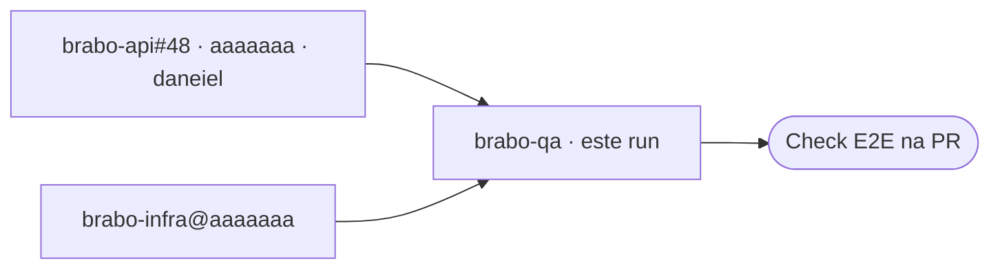

## Vínculos

| Papel | Repo | Ref / PR | SHA | Run |
|---|---|---|---|---|
| Origem | viralabs-dev/brabo-api | [#48](https://github.com/viralabs-dev/brabo-api/pull/48) · daneiel | [aaaaaaa](https://github.com/viralabs-dev/brabo-api/commit/aaaaaaaaaaaaaaaaaaaaaaaaaaaaaaaaaaaaaaaa) | [run](https://github.com/viralabs-dev/brabo-api/actions/runs/123) |
| Este run | viralabs-dev/brabo-qa |  | [bbbbbbb](https://github.com/viralabs-dev/brabo-qa/commit/bbbbbbbbbbbbbbbbbbbbbbbbbbbbbbbbbbbbbbbb) | [run](https://github.com/viralabs-dev/brabo-qa/actions/runs/77) |
| Irmão | viralabs-dev/brabo-infra |  | [aaaaaaa](https://github.com/viralabs-dev/brabo-infra/commit/aaaaaaaaaaaaaaaaaaaaaaaaaaaaaaaaaaaaaaaa) |  |
| Destino |  | Check E2E na PR |  | [abrir](https://github.com/viralabs-dev/brabo-api/runs/5) |

