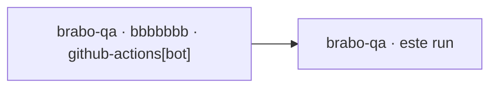

## Vínculos

| Papel | Repo | Ref / PR | SHA | Run |
|---|---|---|---|---|
| Origem | viralabs-dev/brabo-qa | schedule · github-actions[bot] | [bbbbbbb](https://github.com/viralabs-dev/brabo-qa/commit/bbbbbbbbbbbbbbbbbbbbbbbbbbbbbbbbbbbbbbbb) | [run](https://github.com/viralabs-dev/brabo-qa/actions/runs/9) |
| Este run | viralabs-dev/brabo-qa |  | [bbbbbbb](https://github.com/viralabs-dev/brabo-qa/commit/bbbbbbbbbbbbbbbbbbbbbbbbbbbbbbbbbbbbbbbb) | [run](https://github.com/viralabs-dev/brabo-qa/actions/runs/77) |

