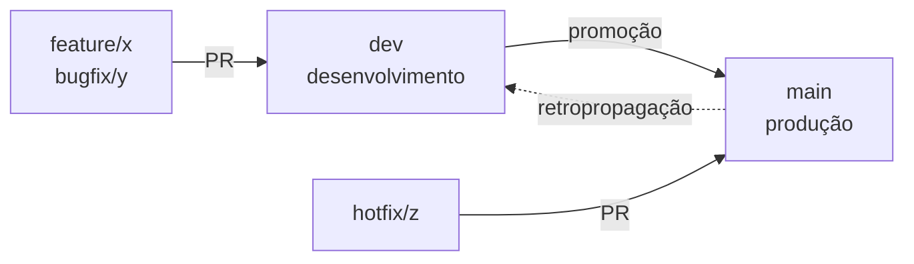
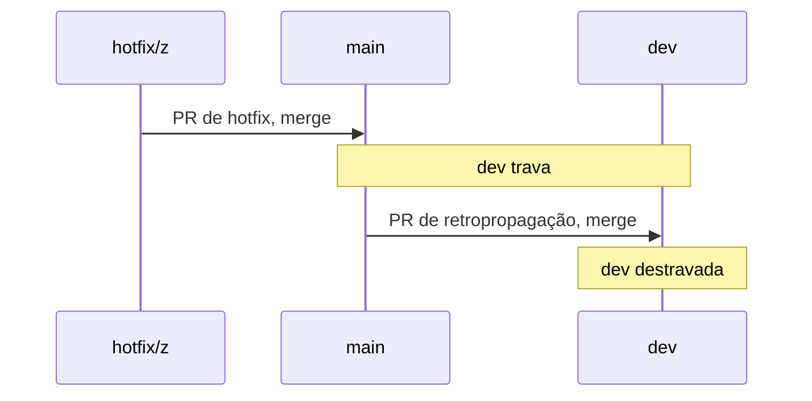

# A política de branches em 10 minutos {#politica-em-10-minutos}

**Para quem é:** qualquer pessoa que nunca viu esta política, seja do time da SmartSky ou de fora, e que foi barrada por um check ou quer copiar a esteira para o próprio produto.

**Depois de ler, você consegue:**
- explicar a esteira `dev → main` e o caminho de um hotfix;
- dizer que versão a sua branch vai gerar, antes de abrir a PR;
- consertar sozinha uma reprovação do `pr-police` ou do `backmerge-gate`, usando o [catálogo de códigos](../reference/codigos-de-violacao.md).

Os termos próprios (esteira, degrau, trava, carimbo) estão no [glossário da política](../reference/glossario-da-politica.md). A versão completa e detalhada é a [Política de branches](branching-policy.md); esta página é o resumo.

## O problema que a política resolve {#o-problema}

Num time pequeno, "combinar" como se nomeia e se mergeia uma branch funciona até o primeiro incidente. Aí aparecem três falhas caras:

1. **Correção que some.** Um hotfix entra direto em produção e ninguém o leva de volta para o desenvolvimento. O próximo release desfaz a correção em silêncio.
2. **Versão negociada.** Cada release vira uma conversa sobre "isso é patch ou minor?". A resposta depende de quem está online.
3. **Deploy de emergência que leva carga demais.** O conserto nasce da branch errada e arrasta tudo o que ainda estava em teste.

A política troca o combinado por regras que um check confere em toda PR. Quem erra recebe a regra, o porquê e o conserto no log, com um link para a explicação.

## A esteira: duas branches permanentes {#a-esteira}

Há duas branches permanentes, **uma por ambiente**. O trabalho nasce de `dev`, volta para `dev` por PR e sobe para `main` por uma PR de **promoção**.

Três regras sustentam o desenho:
- **Ninguém dá push direto** numa permanente. Toda mudança entra por PR.
- **A promoção sobe um degrau por vez** e só entre as permanentes (`dev → main`). Uma PR de promoção é a única que tem `dev` ou `main` como origem.
- **Merge em `main` é decisão da pessoa responsável pelo release.** Nenhuma automação mergeia em branch protegida.

## O hotfix e a retropropagação {#hotfix}

Um incidente em produção não espera a esteira. O `hotfix/` é a única função que **nasce de `main`** e mira `main`. Como `main` passa a ter uma correção que `dev` não tem, o repositório fica em perigo, e é aí que entra a **trava**:

1. O hotfix é mergeado em `main`. O workflow de tag gera a tag PATCH do hotfix e grava a trava (`.release/gate.json`, escrito pelo bot) com `dev` aguardando.
2. A partir daí, o `backmerge-gate` reprova qualquer PR que mire `dev`, **exceto** a retropropagação: a PR de `main` para `dev`.
3. Você abre e mergeia essa PR. A trava sai sozinha e a `dev` volta a aceitar trabalho.

A trava existe para uma garantia: **todo conserto que está em produção também está em desenvolvimento antes de o próximo release sair**. Detalhes em [O portão de retropropagação](branching-policy.md#the-back-merge-gate).

## A função da branch decide a versão {#funcao-versao}

O nome antes da barra não é decoração. Ele é a entrada do cálculo de versão (`scripts/ci/version.ts`), então ninguém negocia a versão depois.

| função | nasce de | PR mira | sobe a versão |
|---|---|---|---|
| `breaking/` | `dev` | `dev` | MAJOR |
| `feature/` | `dev` | `dev` | MINOR |
| `bugfix/`, `perf/`, `refactor/`, `chore/`, `docs/`, `test/` | `dev` | `dev` | PATCH |
| `hotfix/` | `main` | `main` | PATCH |

O ciclo sobe pelo **maior** impacto entre as PRs. Uma `breaking/` e dez `bugfix/` geram um MAJOR.

Quebra de compatibilidade precisa ser dita duas vezes, e o `pr-police` confere as duas: a função `breaking/` na branch **e** um commit com `!` no assunto (`feat(api)!: ...`) ou `BREAKING CHANGE:` no corpo. Mudança que exige ação da pessoa que instala, antes do deploy, nasce em `breaking/` mesmo sendo uma correção. Um PATCH diz "atualize sem pensar", e esse seria um falso aviso.

## O nome da branch {#o-nome}

O formato é `funcao/descritivo`: a função vem da lista fechada acima, a barra é obrigatória e o descritivo não tem espaços. O padrão é `^.{0,30}/\S{0,32}$`: até 30 caracteres antes da barra e até 32 depois.

| nome | resultado |
|---|---|
| `feature/login-por-sso` | aceita |
| `login-por-sso` | reprovada: sem função ([NOME-FORA-DO-FORMATO](../reference/codigos-de-violacao.md#nome-fora-do-formato)) |
| `feature/` | reprovada: sem descritivo ([DESCRITIVO-VAZIO](../reference/codigos-de-violacao.md#descritivo-vazio)) |
| `fix/login` | reprovada: `fix` não está na lista ([FUNCAO-DESCONHECIDA](../reference/codigos-de-violacao.md#funcao-desconhecida)) |

## Três casos para testar o que você entendeu {#tres-casos}

1. **`hotfix/x` aberta contra `dev`.** Reprova em `DESTINO-INVALIDO`: `hotfix/` volta para `main`. Conserto: `gh pr edit <n> --base main`.
2. **`feature/x` com um commit `feat!:`.** Reprova em `MARCADOR-SEM-BREAKING`: ou a branch vira `breaking/x`, ou o marcador sai.
3. **`hotfix/x` criada a partir de `dev`.** Reprova em `ORIGEM-CONTAMINADA`: ela carrega commits que ainda não estão em produção. Conserto: recriar a branch a partir de `main` e levar só o conserto com `git cherry-pick`.

## Para ir além {#alem}

- [Códigos de violação](../reference/codigos-de-violacao.md): o que cada reprovação significa e como consertar.
- [Lições do CI](licoes-do-ci.md): quatro armadilhas do GitHub Actions que moldaram os workflows.
- [Política de branches](branching-policy.md): a fonte completa, com escada de aprovação, promoção e versionamento.
